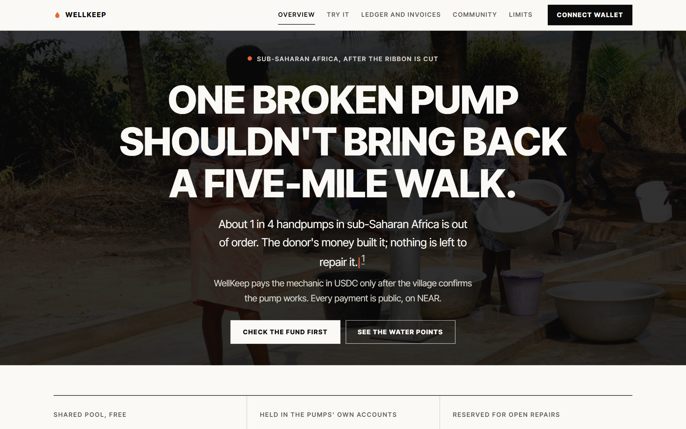
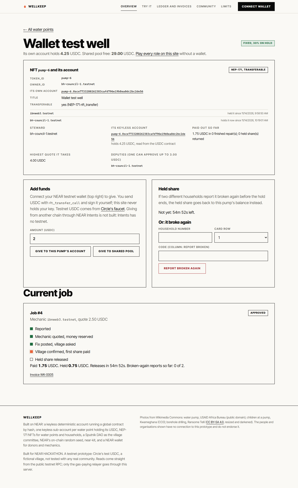
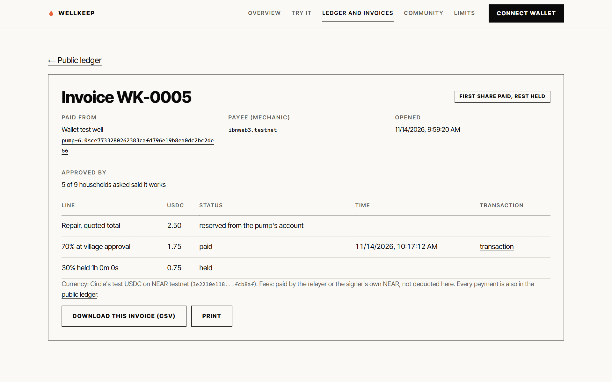
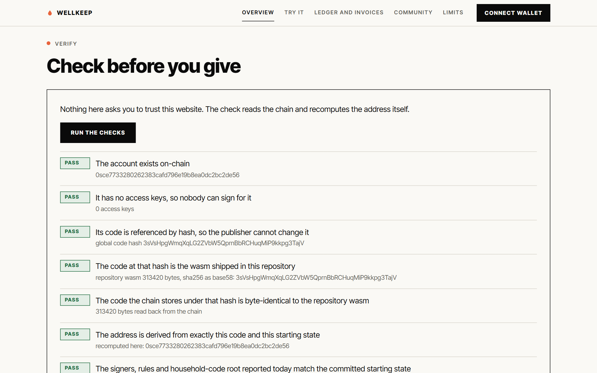
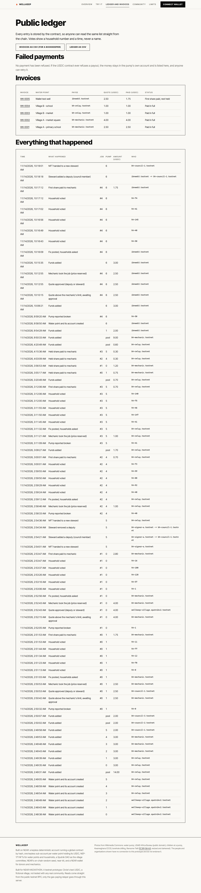
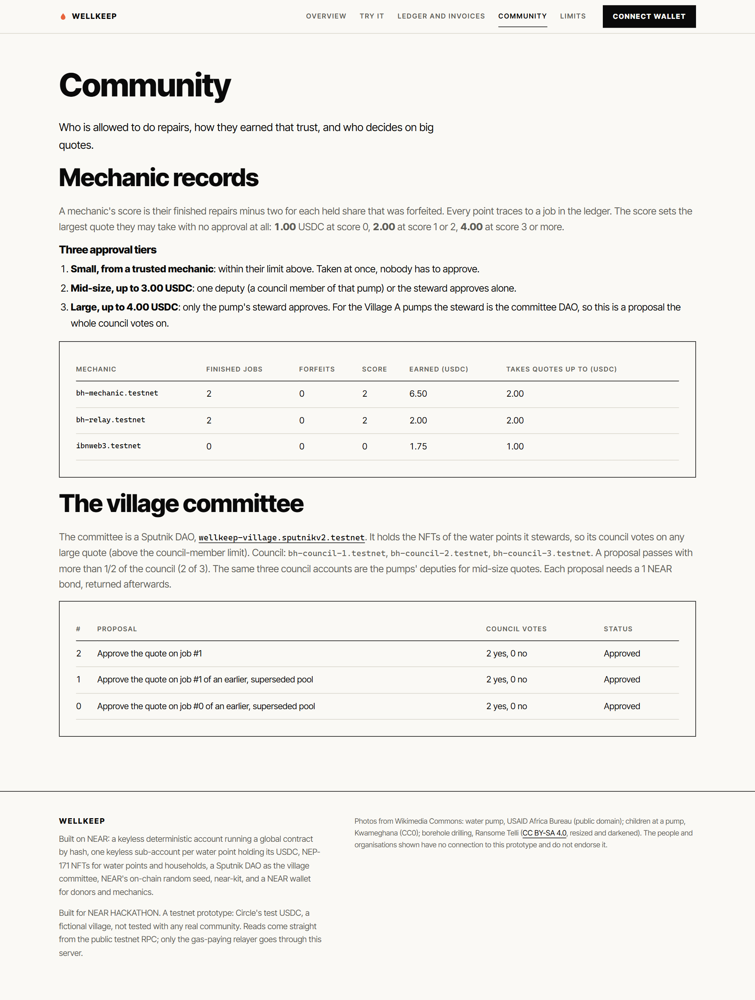
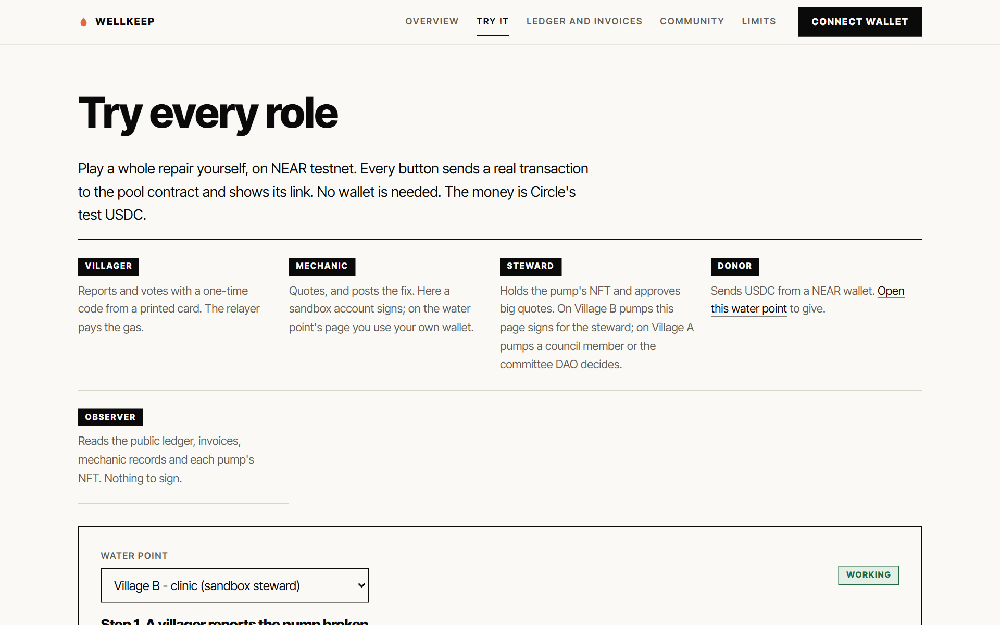

# WellKeep

> **A story first (a made-up village, to show the problem).**
>
> The borehole at Ugbo was drilled with a donor's money. There was a ribbon, a plaque and a photograph. For two years the handpump gave clean water to about three hundred people.
>
> Then the pump's seal wore out. A mechanic in the next town would fix it for the price of a few bags of cement, but there was no fund to pay him, and nobody in Ugbo could prove to a stranger that the money would be spent on the pump. So the women went back to the stream, a long walk away, and the children who carried the water fell sick more often. The plaque is still there.
>
> The same village, with WellKeep: the pump has its own account that holds its repair money, and nobody holds a key to it. A mother in Ugbo reports the pump broken with the one-time code from her household's printed card. A registered mechanic quotes the price. After the repair, her household and about eight others are asked one question: *does it work now?* Only when two thirds say yes does the mechanic get paid, from the pump's own account, and a donor in another country can open the page and see every report, vote and dollar of it.
>
> Ugbo is invented, and so are its people. The problem is not: about one handpump in four in sub-Saharan Africa is out of order at any time ([Foster and others, water point data](https://waterpointdata.org/wp-content/uploads/2020/11/Functionality-of-handpump-water-supplies.pdf)). The money that built them is not the money that keeps them running.

**Demo video (2 min 49 s):** [docs/demo/wellkeep-demo.mp4](docs/demo/wellkeep-demo.mp4)



A public repair fund for community water points, on NEAR testnet. Every water point is an NFT **and** its own keyless account that holds its repair money in USDC. A village committee (a Sputnik DAO) holds the NFTs. A mechanic is paid only after the village confirms the pump works.

**In 30 seconds.** A donor pays for a borehole, then it breaks because nobody has money to fix it. WellKeep keeps a repair fund for each water point, and nobody holds a key to it. A household reports a pump broken with a one-time code from a printed card. A registered mechanic quotes a price in USDC. A small quote from a trusted mechanic goes straight through; a mid-size one is approved by one council member of that pump; a large one needs the pump's steward, which is the holder of the pump's NFT (for Village A, the village committee DAO votes). After the fix, the reporter plus about eight random households are asked "does it work now?". If two thirds say yes, the mechanic is paid 70% at once from the pump's own account and 30% an hour later, unless two different households report the pump broken again. Every report, vote and payment is public. A donor can run one check that proves, from the chain alone, that no key exists for the fund or for any pump's account, and that their code cannot change.

Built on NEAR for NEAR HACKATHON. Tracks: **NFTs That Do Something**, **Real-World Money**, **Social Money**. This is a prototype on testnet with test money (Circle's testnet USDC). It has not been tested with any real community. A second entry from the same author, [Cautio](https://github.com/ibnweb3/cautio) (rental deposits in a keyless NEAR account, [live](https://cautio.ibnweb3lab.workers.dev)), uses the same idea of an account that nobody holds a key to.

Live (testnet): https://wellkeep.ibnweb3lab.workers.dev

## What it looks like

All screenshots are of the live testnet site, taken on 2026-11-14 with test USDC.

**A water point is an NFT and its own account.** The pump's page shows the NEP-171 token, who holds it (the steward), its keyless account, its USDC balance read from the USDC contract, its deputies, and the job in progress. This one was signed from a real wallet (see `evidence/wallet-run.md`).



**Every repair has an invoice**, with the payee, the quote, the 70% and 30% lines, a link to the payment's transaction, and a CSV download.



**A donor can check before giving.** The page reads the chain and recomputes the pool's address in the browser: no access keys, code fixed by hash, same code as this repository.



**One public board** of repairs, payments, failed payments and invoices, and a community page with mechanic records and the committee's proposals.





**Try every role without a wallet.** The Try page lets a visitor report a pump, quote, post the fix and vote through a relayer that pays the gas.



## How it fits each track

Each claim below names what is built and where to see it. What is not built is listed in "Not built" further down.

**NFTs That Do Something: the NFT is the account, and ownership has behaviour.**
- Each water point is an NEP-171 token `pump-N` (`nft_token`, `nft_tokens_for_owner`, `nft_transfer`) and a keyless sub-account `pump-N.<pool>` that holds that pump's USDC. The pool creates the account with the embedded 3,938-byte vault code and **no access key**; the vault can pay out only when the pool tells it to.
- Whoever holds the NFT is the pump's **steward**: they approve quotes above a mechanic's automatic limit and set the highest quote the pump will take. Transfer the token and that control moves; the money stays in the pump's own account.
- What stops the old owner: after `nft_transfer` the contract checks the caller against the new holder on every steward call, and the payee of a job in progress was fixed when the mechanic took the job, so a sale cannot redirect a payout. Unit tests `a_sale_in_the_middle_of_a_payout_still_pays_the_mechanic` and `the_old_holder_loses_quote_approval_after_a_transfer` cover this. It was also run on the real pool (`evidence/live-nft.json`): `pump-5` was transferred to another account, the old holder was refused, the new steward added and removed a deputy, the token went back, the holder list shows all three holders, and the NEP-171 `nft_transfer` events were logged.
- Per-NFT history: holders (oldest first), paid out, finished repairs, forfeits and the quote cap, shown on each water point's page and returned by `get_pump`.
- Household passes (`hh-N`) are NFTs too, but they are credentials for voting and are **not** transferable (`nft_transfer` refuses them).

**Real-World Money: a repair is a paid job with an invoice, in a stablecoin.**
- The money is Circle's testnet USDC (`3e2210e1184b45b64c8a434c0a7e7b23cc04ea7eb7a6c3c32520d03d4afcb8af`, NEP-141). Donors send it with `ft_transfer_call` (`pump:N` or `pool`); mechanics are paid in USDC straight from the pump's account.
- If the USDC contract ever refuses a payout, it is recorded as owed and anyone can retry it (see Honest limits and Evidence). Each job has an invoice page (payer account, payee, quote, the 70% and 30% lines with status, time and a link to the payment's transaction) and a CSV export for a bookkeeper, per job and for the whole ledger (page **Ledger and invoices**). The transaction links come from the NEAR explorer's token-transfer index; if it is unreachable the cell links to the pump account's transfers instead.
- Gasless for villagers and for the sandbox: a relayer pays the fee. Real mechanics and stewards sign with their own wallet and need a little testnet NEAR (a full meta-transaction relay for them is not built).

**Social Money: a shared budget, a committee, and reputation tied to finished work.**
- The village committee is a real **Sputnik DAO** (`wellkeep-village.sputnikv2.testnet`, three council accounts, 2 of 3 to pass). It holds the NFTs of the Village A pumps, so approving a big quote is an ordinary DAO proposal. No new multisig was written for this.
- Reputation: a mechanic's score is their finished repairs minus two for each forfeited held share; every point traces to a job in the ledger. Score sets the largest quote they may take with no approval: 1 USDC at score 0, 2 USDC at score 1 or 2, 4 USDC at score 3 or more.
- **Three approval tiers.** (1) Small, within the mechanic's limit: taken at once. (2) Mid-size, up to 3 USDC: one **deputy** (a council member the steward has named for that pump) or the steward approves alone. (3) Large, up to 4 USDC: only the steward approves, which for the Village A pumps is a proposal the whole DAO council votes on. The three DAO council accounts are the deputies of the Village A pumps. Unit tests cover each tier, including a deputy being refused above the limit.
- A public board of repairs, claims, payouts and mechanic records: **Ledger and invoices** and **Community** (mechanic records and the committee's proposals).

## Try it (about five minutes)

Do each step on the live site and check the result named after it.

1. **Check before you give:** open **Overview**, press **Run the checks** - see eight PASS lines: the pool account exists, has 0 access keys, its code is referenced by hash and equals this repository's wasm, its address recomputes in your browser, its rules match the committed starting state, and every one of the 6 pump accounts has no keys and runs exactly the vault code in this repository.
2. **Play every role, no wallet:** open **Try it**, pick a "(sandbox steward)" water point, press **Report this pump broken** - see a transaction link. Then **Send the quote**: choose 0.50 or 1.00 USDC (accepted at once), or 2.50 or 4.00 USDC (it waits: press **Approve as the steward**). Then **Post the fix**, **Make the village say it works** - see "paid" with 70% sent from the pump's own account and 30% held for an hour.
3. **See the tiers on real jobs:** open **Ledger and invoices**. Invoice `WK-0001` is a 2.50 USDC mid-size quote on the Village A primary school, approved by **one council member alone** (`bh-council-1`), paid 1.75 USDC from that pump's own account with 0.75 held. Invoice `WK-0002` is a 4.00 USDC large quote on the market square: the same council member was refused, then DAO proposal 1 passed with 2 of 3 votes (open **Community**), and 2.80 USDC was paid with 1.20 held. Each payment line links to its transaction. `evidence/live-run-v3.json` has the hashes of the report, quote, approval, fix and votes.
4. **See the NFT and its account:** open **Overview**, then "Village A - market square" - see `pump-0` with its owner (the DAO), its own account and its live USDC balance read from the USDC contract.
5. **Download the books:** on **Ledger and invoices** press **Invoices as CSV** - get one row per job.

Run it locally:

```bash
npm install
npx wrangler dev          # needs .dev.vars with RELAY_KEY (a testnet key), see "Run it yourself"
```

Real roles with real wallets (not needed for judging): connect a NEAR testnet wallet, open a water point, give USDC (`ft_transfer_call`), or sign in as a registered mechanic to quote and post the fix, or as the steward (the NFT holder) to approve a quote or transfer the NFT.

## What is on-chain and what is not

On NEAR testnet, real:

- A **keyless pool account**: `0sce7733280262383cafd796e19b8ea0dc2bc2de56`, no access keys. Its code is a global contract referenced **by hash** (`3sVsHpgWmqXqLG2ZVbW5QprnBbRCHuqMiP9kkpg3TajV`, 313,420 bytes), so nobody can swap it. (Two earlier pools from this same hackathon build are superseded, one without the deputy tier and one without payout recovery; their files are in `evidence/v2/` and `evidence/v3/`.)
- **Six keyless pump accounts** `pump-0` to `pump-5` under the pool, each running the same 3,938-byte vault (`3Pcz3nieBrewZPiwqBuepTU6x2aHGvUc2WziCxGJZB2D`), each with 0 access keys.
- The repair rule: reports, quotes, three approval tiers, one-time-code voting, the random sample, the 70/30 payment and the forfeit rule (`contract/src/lib.rs`).
- The USDC held by each pump is in that pump's own account on the USDC contract, not a number inside the pool.
- Admin actions (register a mechanic, add a pump, cancel a disputed job) need both signer accounts to approve the same action.
- A village committee Sputnik DAO and a DAO proposal that was voted on and executed `steward_approve` on the pool, plus a mid-size quote approved by one council member alone.

Not real, and labelled as such on the site:

- The money is **Circle's testnet USDC**. It has no value. Nothing here touches mainnet.
- **Mobile-money cash-out is not built.** No fiat on-ramp or off-ramp exists in NEAR's docs, and none is faked here.
- **NEAR Intents top-ups are not built.** Intents has no testnet, so cross-chain giving cannot be shown honestly.
- **The SMS gateway is not built.** The design assumes a feature phone sends the code by SMS; this build uses the browser.
- The village is fictional: six water points in two fictional villages and 30 households with generated cards. The sample cards are public (`docs/test-cards.json`) so a reviewer can try the flow.
- The three council accounts of the DAO and the two admin signers are accounts the author controls. A real village would choose its own people.
- On the Village B pumps the sandbox account `bh-relay.testnet` is both the steward and the sandbox mechanic, so one visitor can walk the whole flow. The contract does not forbid a steward from also being the mechanic; a real committee should not do that.
- The hold period is one hour so a reviewer can see the release; a real deployment would use days or weeks. It is a parameter fixed in the pool's starting state.
- A plain USDC transfer to a pump's account is held safely but is not counted by the pool until credited. Use `ft_transfer_call` (the site's buttons do).
- Wallet signing goes through `@hot-labs/near-connect` (its wallet list loads on the live site: Meteor, Intear, Ledger, Nightly and others). Every wallet-signed button was proven with a real wallet on 2026-11-14: the builder connected `ibnweb3.testnet` with Meteor Wallet on the live site and donated USDC, sent a quote as a registered mechanic, approved it as the steward, posted the fix, added a deputy and handed the pump's NFT to another account. The ledger entries are in `evidence/wallet-run.md`. The only wallet not tried is a deputy's own approval of a mid-size quote from a wallet (that path is proven through the DAO and command line). The same contract calls are proven from the command line, through the relayer and sandbox, and through the DAO (see Evidence).

## How it works

```
donor ──ft_transfer_call(USDC, "pump:N")──▶ pool ──▶ pump-N.<pool>  (keyless account, holds the USDC)
household card ─(one-time code)─▶ report_broken ─▶ job opens
mechanic ──accept_job(quote)──▶ within their limit: money reserved
                              ├─▶ up to 3 USDC: one deputy (council member) or the steward approves
                              └─▶ up to 4 USDC: only the steward (NFT holder; a DAO vote for Village A)
mechanic ──post_fix──▶ contract draws a random sample
asked households ──vote(code)──▶ ≥5 replies and ≥2/3 "works" ─▶ pump-N pays 70% to the mechanic, 30% held
hold ends, no forfeit ─▶ release_held (anyone) ─▶ pump-N pays the 30%
2 different households report again during the hold ─▶ the 30% stays in the pump's account
```

- **Household cards.** Each household has a card with a row of codes per use: one for "report", one for "works", one for "still broken". Only a Merkle root of all code hashes is stored on-chain. A code works once. A relayer submits calls, so households need no wallet.
- **Random sample.** When the fix is posted the contract draws eight households using NEAR's on-chain random seed. The mechanic cannot know whom to bribe in advance. (Block producers have slight influence over the seed; acceptable at these stakes, and said so.)
- **Why two stages, no bond.** Field research found that a mechanic bond punishes honest mechanics (worn parts, dry sources). The held 30% is the incentive.
- **Why one account per pump.** The money for a water point is physically in that pump's own account, so a donor can read it from the USDC contract, and the NFT that controls the pump is the token of that account.

## NEAR integration map

| NEAR feature | What it does here | Where |
| --- | --- | --- |
| NEAR testnet | Holds the fund, jobs, votes and the public ledger | `wrangler.toml` (`POOL_ID`), `evidence/publish.json` |
| Global contract, referenced by hash | The pool's code lives once on-chain under hash `3sVsHpgWmqXqLG2ZVbW5QprnBbRCHuqMiP9kkpg3TajV`; the pool points at the hash, so nobody can swap it | `tools/publish.mjs`, `web/src/verify-core.js` (checks 3 to 5) |
| Deterministic `0s` account | The pool address is derived from its code and starting state and has no access keys | `tools/publish.mjs create`, `evidence/state-init.json`, `web/src/verify-core.js` |
| Sub-accounts | Each water point gets a keyless account `pump-N.<pool>` created by the pool, running embedded vault code | `contract/src/lib.rs` (`Action::AddPump`), `vault/src/lib.rs` |
| NEP-171 NFTs | `pump-N` transfers and carries stewardship; `hh-N` are non-transferable credentials. `nft_token`, `nft_tokens_for_owner`, `nft_supply_for_owner`, `nft_transfer`, mint and transfer events | `contract/src/lib.rs` (NFT section) |
| NEP-141 (Circle testnet USDC) | The money: `ft_transfer_call` in, `ft_transfer` out of each vault, registration with `storage_deposit` | `contract/src/lib.rs` (`ft_on_transfer`, `pay_out`), `vault/src/lib.rs` |
| Sputnik DAO | The village committee; holds the Village A pump NFTs and votes on big quotes | `tools/dao.mjs`, `web/public/app.js` (Community page) |
| NEAR on-chain random seed | `env::random_seed()` draws the households asked to vote | `contract/src/lib.rs` (`draw_sample`) |
| near-sdk (Rust) | The pool contract (55 unit tests in `contract/src/tests.rs`) | `contract/` |
| near-sys (no SDK) | The 3.9 KB vault written against the host functions directly | `vault/` |
| near-kit | The Worker's relayer pays gas and signs calls; the tools sign testnet calls | `web/src/worker.js`, `tools/` |
| NEAR wallet (`@hot-labs/near-connect`) | Donors, mechanics and stewards sign with their own accounts | `web/src/wallet.js` |
| Multi-signature admin | Registering a mechanic or adding a pump needs both signer accounts | `contract/src/lib.rs` (`approve_action`), `tools/admin.mjs` |
| NEAR RPC and Explorer | The page reads the chain directly over RPC and links every transaction | `web/public/config.json`, `web/public/app.js` |

## What NEAR gives, and what would work anywhere

- **The address proves the rules.** A NEAR deterministic account's address is derived from its code and starting state, and it has no keys. The page recomputes that address in the browser and checks over RPC that there are no access keys, that the code is referenced by hash, that the stored code is byte-identical to `evidence/wellkeep_pool.wasm`, and that every pump account has no keys and runs the exact vault code.
- **The token is the account.** A water point's NFT and the account that holds its money are the same thing on NEAR: a sub-account that the contract creates with no key. Ownership of the NFT is control of the pump; the money does not move on transfer.
- **A committee that is an ordinary DAO.** The pump NFT can be held by a Sputnik DAO, so approvals are DAO proposals with no new multisig code.
- **Measured costs on testnet.** Publishing the 313,420-byte pool code by hash burned 31.37 NEAR once; creating the keyless pool from it cost about 0.01 NEAR; each pump account needs about 0.1 NEAR for its storage.
- **What would work on any chain:** the repair rule itself (reports, quotes, sample vote, two-stage payment). An EVM version with a factory, per-pump contracts and a paymaster could do much of it. We do not claim only NEAR can do this. What NEAR adds is narrower: addresses that prove their own code, tokens that are the accounts holding the money, and a committee that is an off-the-shelf DAO.

## Prior art, and what is different

Pooled maintenance funds paid by mobile money already work. FundiFix in Kenya pools monthly M-PESA payments across communities, verifies repairs with handle sensors, and reports (and a peer-reviewed Kwale study found) about 90% of repairs within three days; I did not re-check the study myself. A Rwanda trial showed sensor-triggered repair beats scheduled visits. WellKeep does not replace any of that.

What is different: the fund is public and keyless, so a donor can see and check where the money goes without trusting an operator, a committee treasurer or us. I found no independent blockchain water-maintenance pilot; one 2020 IBM/SweetSense blockchain pilot is cited without a known outcome.

## Honest limits

- **A vote is not proof the pump works.** It records that households said so. A sensor is stronger; this is the cheap fallback where sensors are not affordable.
- **The household roll is a one-time trust point.** Two independent signers enrol it. If both are dishonest they can pad it.
- **Cards can be bought or stolen.** Keep each payout below the cost of buying enough codes.
- **Votes are linkable to a card.** Anyone who knows which card is whose can see how it voted.
- **A held share can be denied by two dishonest households.** Two reports forfeit it. The mechanic has no appeal in this version.
- **No phone coverage means no votes.** The design leans on SMS and printed cards; this is untested.
- **Refused payouts are recoverable, with limits.** If the USDC contract refuses a payout, the pool's callback records it as *owed*: the money stays in the pump's account, the ledger says so, and the paid totals no longer count it. Anyone can press **Retry payment** on the ledger page; the pool first registers the payee with the token, then the pump's vault pays again. If the payee's account is gone, both signers can point the payment at another account (`node tools/admin.mjs reassign-owed`). This was proven on testnet with a token that can be told to refuse (`evidence/scratch-recovery.md`), not with Circle's USDC, which cannot be made to refuse a registered account on demand.
- **The sandbox is finite.** The household roll has 150 households with 6 one-time card rows each (900 rows; a full repair uses 6), so about 150 full repairs fit on this pool, and it spends test USDC. Every ten minutes the relayer (the sandbox mechanic) returns the USDC it was paid above a small float to the shared pool, so the demo refills itself; `/api/*` is rate limited by an exact Durable Object counter (30 requests a minute per caller, 120 for everyone). Many callers together could still exhaust the card rows or the relayer's NEAR for gas. Real use needs more card batches (the contract supports adding them; the demo page uses one).
- **A committee can be captured.** The DAO is as honest as its council, and one deputy can approve a mid-size quote alone. Quotes within a trusted mechanic's limit need no approval at all.
- **Real money.** Nigeria and Kenya tightened stablecoin rules in November 2026, and I found no evidence of rural mechanics using stablecoins. A real deployment needs a licensed off-ramp partner.
- **Donor demand is unproven.** I found no evidence that small donors would fund maintenance over new wells.
- **"Five-mile walk" is an illustration.** The headline is rhetoric; I have no source for a typical distance. The "about one in four handpumps out of order" line is from Foster and others (2018), whose abstract says approximately one in four handpumps in sub-Saharan Africa are non-functional at any point in time; the paper warns that definitions of "functional" differ.
- **Not tested with any village.** It needs a field pilot.

## Evidence

- `evidence/verification.json` - the eight checks, run against the live pool.
- `evidence/live-nft.json` - the pump NFT transfer, deputy changes and NEP-171 events on the real pool, with transaction hashes.
- `evidence/live-run-v3.json` - two live repairs on the real pool with real Circle USDC: a 2.5 USDC quote approved by one council member alone, and a 4 USDC quote where the council member was refused and DAO proposal 1 (2 of 3 votes) approved it; five household votes each; 1.75 and 2.80 USDC paid from the pumps' own accounts, with the transaction hashes of the report, quote, approval, fix and votes.
- `evidence/publish.json` - code hash, publisher, pool address. `evidence/wellkeep_pool.wasm`, `evidence/wellkeep_vault.wasm` and `evidence/state-init.json` - the exact code and starting state the addresses commit to.
- `tools/scratch-v2.mjs` - the same flow on a throwaway pool, run with a mock NEP-141 token before publishing: donation routing, the big-quote gate, an NFT transfer in the middle of a job (the old holder is refused), the 70/30 payout from the vault, the reputation update, and a deputy refused on a quote above the council-member limit.
- `contract/` - 55 unit tests (`cargo test`); `tests/` - JS tests for the card codes and the verifier, including a negative control (the same code deployed the ordinary way, with a key and no hash reference, fails the checks).
- `evidence/wallet-run.md` - a real wallet (Meteor, testnet) pressing donate, quote, steward approve, post fix, add deputy and NFT transfer, with the ledger entries.
- `evidence/scratch-recovery.md` - the failed-payout recovery run on testnet (a mock token that can refuse), with the output.
- `evidence/v2/`, `evidence/v3/` - the two previous pools of this build (no deputy tier; no payout recovery) with their live runs, kept as history. `evidence/borehole_pool.wasm`, `evidence/live-run.json` - the first version (non-transferable records, NEAR instead of USDC).

## Run it yourself

```bash
# tests
npm install
npm test                                  # JS tests (need internet for some; npm run test:offline skips those)
cd contract && cargo test --features state-tool

# build both wasm files (Linux/WSL, Rust + wasm32 target + binaryen); the pool embeds the vault
bash tools/build.sh
bash tools/state-init.sh                  # the pool's exact starting state

# publish and create (testnet; accounts/keys in .keys/, gitignored)
node tools/cards.mjs 150 6
node tools/publish.mjs publish            # burns ~29 testnet NEAR once per code version
node tools/publish.mjs create
node tools/bootstrap.mjs                  # mechanics and six pumps (each creates its keyless account)
node tools/dao.mjs create                 # the village committee Sputnik DAO

# the site
node tools/sync-web.mjs                   # bundles the verifier, copies evidence
npx wrangler dev                          # needs .dev.vars: RELAY_KEY (a testnet key)
```

The Worker's `/api/*` rate limits are exact counters in a Durable Object (`Limiter` in `web/src/worker.js`, declared in `wrangler.toml`); the page tries four public testnet RPC endpoints in turn (`web/public/config.json`).

## AI use disclosure

I built this with Claude Code (Anthropic) as a pair-programming agent: the contracts, tests, tooling, web app and this README were written with it. The design (donor-first, household cards, random sample, two-stage payment, one account per pump, NFT stewardship, DAO committee) was worked out in conversation, and the field-evidence section came from a separate research report that I did not independently verify beyond the peer-reviewed sources. Photos in the site are from Wikimedia Commons (credits in the page footer). The visual style was inspired by the Framer template Satz; no template code or assets were used. No other templates or boilerplate: the Worker config is the standard `wrangler` layout. Libraries: `near-sdk` (Rust), `near-sys`, `near-kit`, `@hot-labs/near-connect`, `esbuild`, `wrangler`; the page uses Google Fonts (Inter Tight). No code from before the hackathon window.

## License

MIT
